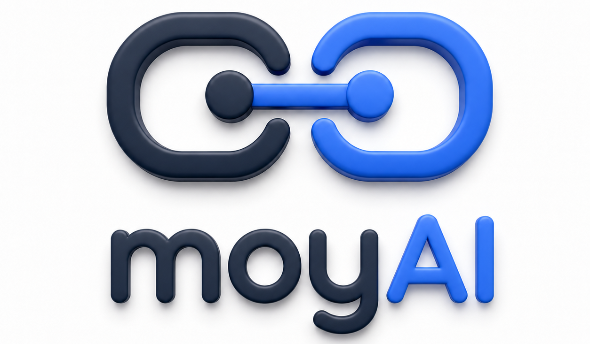
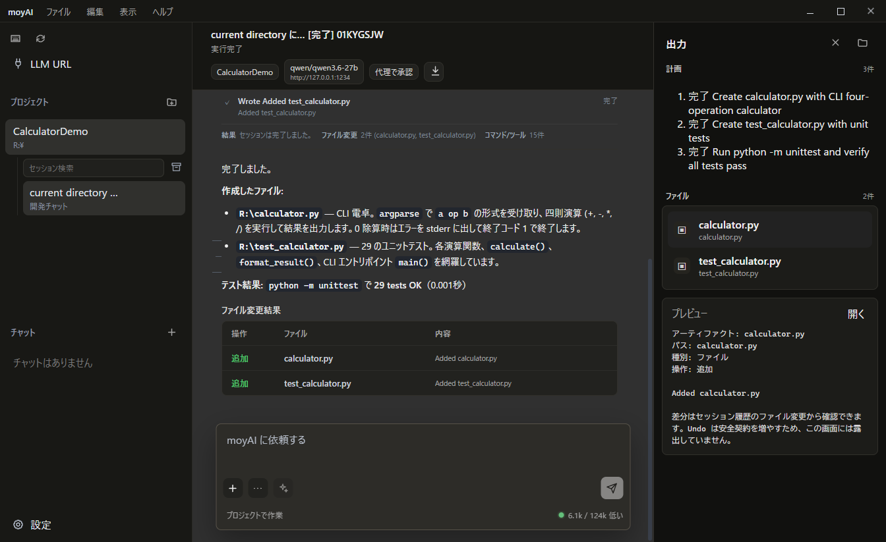

<p align="center">
  
</p>

<h1 align="center">moyAI</h1>

<p align="center"><strong>ローカルLLMと閉域環境のためのコーディングエージェント。</strong></p>

<p align="center">
  <a href="README.md">English</a> ·
  <a href="https://github.com/midi-ai-labs/moyAI/releases/tag/v2.1.1">公開済み v2.1.1</a> ·
  <a href="#quick-start">Quick Start</a> ·
  <a href="#license">ライセンス</a>
</p>

<p align="center"></p>

## moyAI（もやい）とは

moyAIは、Desktop・CLI・TUIから使えるRust製のコーディングエージェントです。外部のOpenAI互換LLMサーバーへ接続し、プロジェクトを調べ、ファイルを編集し、コマンドを実行します。会話と成果も保存します。LLMサーバーやモデルの起動・終了・ダウンロードは行いません。

**Desktop 3.0.0はWindows x64向けで、moyAI Hub 0.1.0と組み合わせて使います。** このWindows配布物はWebView2とx64 VC++ runtimeが導入済みのPC向けです。公開済みv2.1.1のZIPは従来の配置と機能です。実装内容・受入確認の証拠・検証上の制限は[3.0.0リリースノート](docs/release/v3.0.0.md)を参照してください。

## できること

- ローカルプロジェクトとチャット、ファイル添付、作業内容・成果・保存済み会話の確認。
- メインの会話や選択内容について質問する、ツールを使わない独立したサイドチャット。
- 「承認を求める」「代理で承認」「フルアクセス」の操作権限。前二つにはWindowsの作業フォルダー保護が適用されます。
- 子エージェントとの分担、進捗計画、長い会話の圧縮、Markdownへの会話保存。
- プロジェクト内の指示・Skills、外部HTTP MCPツール、文書処理用Doclingとの接続。
- Hubで許可した複数PCを使うプロジェクト。左のプロジェクト一覧に `Hub` 印で表示し、いつもの入力欄から依頼します。AIはプロジェクト内で許可された実行PCを選択できます。
- Desktop画面と独立して仕事を実行するWindows Runner。共有の会話・入力・公開した成果はHubへ保存します。

文書の作成・編集と説明用コメントには、[yomiyasu](https://github.com/nanaism/yomiyasu)を参考にした文章基準を組み込んでいます。主張や技術条件を保ち、冗長な説明や不自然な言い回しを減らすようAIに指示します。設定やスキルのインストールは不要です。

## Quick Start

3.0.0のWindows配布物では、次の順に進みます。

1. ZIP全体を展開して `Setup-moyAI.cmd` を通常の権限で実行します。初回導入または共通sandbox helperの更新時だけ別画面で管理者承認し、取り消すと利用者側アプリの導入前に中止します。以後はスタートメニューから **moyAI** を開き、起動ごとのUACはありません。インストールせず使う場合も共通helperが必要です。[Windows導入手順](docs/user/windows-setup.md)を参照してください。
2. 初回画面で目的を選びます。

   | 目的 | 選ぶ項目 |
   | --- | --- |
   | 自分のPCで作業する | 自分のPCで使う |
   | チームへ仕事を依頼する | チームに参加する |
   | このPCでチームの仕事を実行する | チームの仕事をこのPCで実行する |
   | Hubを準備する | チーム環境を用意する |

3. 個人利用ではAIの接続先・モデル・承認方式を保存し、プロジェクトのフォルダーを追加するかチャットを始めます。
4. チーム利用では、管理者から受け取った `hub-config.moyai-join` を開きます。管理者がPCの参加とプロジェクトでの用途を許可します。実行PCでは実行許可とプロジェクトごとの作業フォルダーも設定します。依頼だけをするPCにローカルAIや実行フォルダーは不要です。
5. プロジェクトを開いて依頼し、必要な操作承認、回答、成果ファイルを確認します。

moyAIのID・パスワード入力は不要です。同じWindowsユーザー名でも各PCは別のIDと鍵を持ちます。Hubへ参加しただけで全プロジェクトが使えるわけではありません。

Desktopの×ボタンを押すとトレイに入り、仕事は続きます。もう一度起動すると同じ画面に戻ります。メニューまたはトレイの **終了** は、このPCのRunnerの仕事と起動中アプリを停止します。Runnerの終了を確認してからDesktopも終了します。Hubは別に管理します。

詳しい手順は[使い始める](docs/user/getting-started.md)、[Windowsへの導入と更新](docs/user/windows-setup.md)、[初回設定と再開](docs/desktop-first-use.md)、[Hubプロジェクトの操作](docs/shared-work-desktop.md)を参照してください。公開済みv2.1.1は `bin/moyai-desktop.exe` から起動します。

## 設定

Windowsの共通設定は `%APPDATA%\midi-ai-labs\moyai\config\config.toml` です。保存済みの利用者設定を製品の初期値で上書きしません。

**設定 → AIの接続** でメインとサイドを設定します。Hub設定がない場合は、接続方式・URL・モデルを入力します。LM Studio Responses、oMLXなどのOpenAI互換Chat Completionsに対応し、モデル一覧の取得とモデルIDの直接入力ができます。API認証が必要な場合は、秘密情報そのものではなく、それを保持する環境変数名を指定します。

Hub設定がある場合は同じ欄にHubの接続情報を表示し、標準モデルまたは登録済みモデルを選びます。メインとサイドは別々に保存し、共有Runnerは実行PCのメインの選択を使います。Hub停止中に手入力の接続先へ自動で切り替わりません。

**接続設定をリセット** はHubが応答しなくても使えます。手入力のAI設定・ローカル会話・成果を保持して、別Hubへ登録し直せます。

共通設定と、選択したローカル会話のメイン用設定は別です。サイドは独立した共通設定を使います。`context_window` はmoyAI内の会話量の計算と圧縮に使います。モデルの読み込み・生成量・サンプリングはAIホストで設定します。[設定例](config.example.toml)と[Hubモデル接続](docs/hub-integration.md)を参照してください。

自動圧縮を始める入力トークン数は、共通設定の `model.compaction_budget_tokens`（環境変数 `MOYAI_COMPACTION_BUDGET_TOKENS`）で指定できます。未指定なら通常の作業用上限を使います。正の値で、`context_window` から求めた実効入力上限以下にしてください。指定値と通常の作業用上限の小さい方で自動圧縮を始めます。`context_window = 131072`、設定値 `98304` の場合、入力の推定値が98,304トークンに達すると自動圧縮します。Hub経由のメインや共有実行にも適用し、生成量はAIホストで設定します。

モデルは `compact_context` へ自分で作った短い作業要約を渡し、文脈を整理することもできます。moyAIは最新の利用者入力と直近の完了済み作業を保持し、文脈が減ることを確かめて既存の会話履歴へ保存します。元の発言やツール結果は残ります。[Context Language Models](https://github.com/facebookresearch/context-language-models)の考え方を参考に、moyAIの履歴・ツール構成に合わせて実装しています。

## CLI・TUI

```bash
moyai run --dir /path/to/workspace "このプロジェクトの主要モジュールを調べて要約してください。"
moyai tui --dir /path/to/workspace
moyai desktop --dir /path/to/workspace
moyai model availability --base-url http://omlx-host:8119/v1 --provider-profile openai_compatible
```

3.0.0配布物の実行ファイルは `app/bin/` にあります。CLI・TUI・DesktopはRustの共通実装と利用者設定を使います。引数の詳細は `moyai --help` と各コマンドのヘルプで確認してください。

WindowsのRunとTUIは、導入済みsandbox helperを使い、起動時のUACは不要です。help・versionや実行を始めないmetadata commandではsandbox helperを起動しません。

## プロジェクトごとの指示

`AGENTS.md`、`CLAUDE.md`、`.moyai/rules*`、`.moyai/commands/*.md`、ローカルの `SKILL.md` を利用できます。ファイルとツールの利用範囲は、選択した作業フォルダーと操作権限に従います。Hubプロジェクトへ再参加するときも、AIが通常の作業として実ファイルから状態を把握し、専用の履歴復元処理は行いません。

外部MCPツールとの接続は引き続き使えます。moyAI同士の旧手動配信は新規導入の入口ではなく、現在はHubプロジェクトを使います。旧記録は[MCP履歴](docs/mcp-history-guide.md)から参照できます。

## 操作権限と利用上の制限

主な導入・検証対象はWindows x64です。WebView2とVisual C++ランタイムは配布物へ同梱するか、組織側で導入します。Setupによるダウンロードはなく、利用先にRust・Node・開発サーバーは不要です。

「承認を求める」と「代理で承認」は同じWindowsの作業フォルダー保護を使い、後者はAIが操作の許可を審査します。「フルアクセス」は現在のWindows利用者の権限で実行します。これはOS全体の完全隔離を保証するものではありません。ネイティブなプロセス保護はWindowsのみで、他OSでは保護が必要なプロセス操作を拒否します。Unixの既存ファイル更新・削除は、バックアップを残した部分完了エラーになる場合があり、表示された保存先の確認が必要です。

管理者による導入で、WindowsのProgram Files配下に固定のsandbox helperと、必要時にLocalSystemで開始する `MoyAISandbox` サービスを配置します。実行物と登録設定は管理者とSYSTEMだけが変更でき、通常利用者は照会と開始だけができます。通常アプリとRunnerは一般ユーザー権限のまま動作し、この導入で個々のtool操作を許可したり、失敗した制限付きcommandをフルアクセスで自動再実行したりしません。現在のsandboxはlocal Windows SAM accountを対象とし、非対応のaccount種別やhelperの検証失敗では起動を中止します。許可済みworkspace / TEMP内での標準Python private directoryとpytest一時directoryの利用は、project fileの変更や制限外実行の依頼なしに動作することが要件です。workspace外や別effectへの制限は別に確認します。

通常の配置フォルダーから起動してください。helperや同梱runtimeまでのpathにjunction・symbolic linkなどのreparse pointがある場合は起動を拒否するため、配布物全体を通常のフォルダーへ移してください。

停止や発言の編集は、作成済みファイルや起動済みアプリを元に戻しません。編集・再送できるのは最新の発言だけです。本文を編集しても元の画像や添付は保持します。添付を変更する場合は、新しい依頼として送ってください。停止要求の受付と、実プロセスの停止確認は別です。

RunnerはWindows利用者のログオン中に動作します。Desktopと、ログオン時自動起動を含む独立Runnerは、UACなしで導入済みhelperを使い、それぞれlifetime leaseを保持します。利用がなくなるとhelperは停止しますが、Runner自体をWindows serviceとして動かすわけではありません。共通helperの更新・明示的なPC全体からの削除だけ管理者承認が必要で、サービス稼働中は拒否します。利用者別アプリの削除では、他の利用者のために共通helperを残します。HubのルートCAの自動入替、初期状態のPC・物理別PCでの正式配布受入は、ローカル自動試験の成功だけでは確認できません。モデルの回答品質とツール対応は接続先に依存します。[共有Runner](docs/runner-shared.md)、[ローカルRunner](docs/runner-local.md)、[継続コマンド](docs/managed-shell-guide.md)も参照してください。

## 開発・検証

```bash
npm ci
npm run build:desktop-web
cargo build
```

変更内容に応じて次の検証を選びます。

```bash
cargo fmt --all -- --check
cargo check --all-features
cargo test -- --test-threads=1
npm run test:desktop-web
npm run verify:gui -- --suite smoke
```

Windowsのnative sandbox試験には、明示的に起動承認したhelper testhostが必要です。対応するlibtestのビルドと実行は[Windows sandbox試験ガイド](docs/testing-windows-sandbox.md)に従ってください。

[GUI自動試験](tests/desktop_e2e/GUI_AUTOMATION.md)と[手動試験](tests/manual_ST/README.md)に入口があります。実画面・実際のLLMによる確認と、試験用データによる検証は区別します。実装の詳細は[src](src/)と[複数PCの設計](docs/design/multi-device-session.md)、対応するテストを参照してください。

RCの元となる実装で、Manual ST Case1〜7と復元試験を実施しました。最新の仮想WinA/WinBでは、固定応答・実LLMの両方で実行・成果受渡し・終了処理の自動確認に通っています。組合せはHub 0.1.0（`f437c4fe0191e69f0ff7f0affa16eb191db305f3`）で、同じWindows PC上の試験です。生成コードの評価NGとSide Chat回答の精度不足は記録を保持しており、試験の実施完了を全回答の合格とは扱いません。正式3.0.0配布物の最終受入結果と識別情報は、開発workspaceの `project_sandbox/release-3.0.0-20261016/RESULTS.md` に記録します。RCの結果とは区別します。新規PCへの導入、物理別PC・LAN・Firewallは未確認です。

公開配布はcleanな確定commitから `scripts/package-release.ps1` で作成します。Desktop・CLI・Runner・cleanup・sandbox helperを再ビルドし、版とcommitに対応する手動GUI証跡、Hub同梱時は実バイナリの組合せ証跡を確認します。資材と引数は[配布を作る担当者向け](docs/user/windows-setup.md#配布を作る担当者向け)を参照してください。配布物の実動作確認後に、ZIP・manifest・SHA256を公開します。

## License

[MIT](LICENSE)。Copyright (c) 2026 Hideyoshi Takahashi。`midi-ai-labs` は本個人プロジェクトのGitHub namespaceです。
